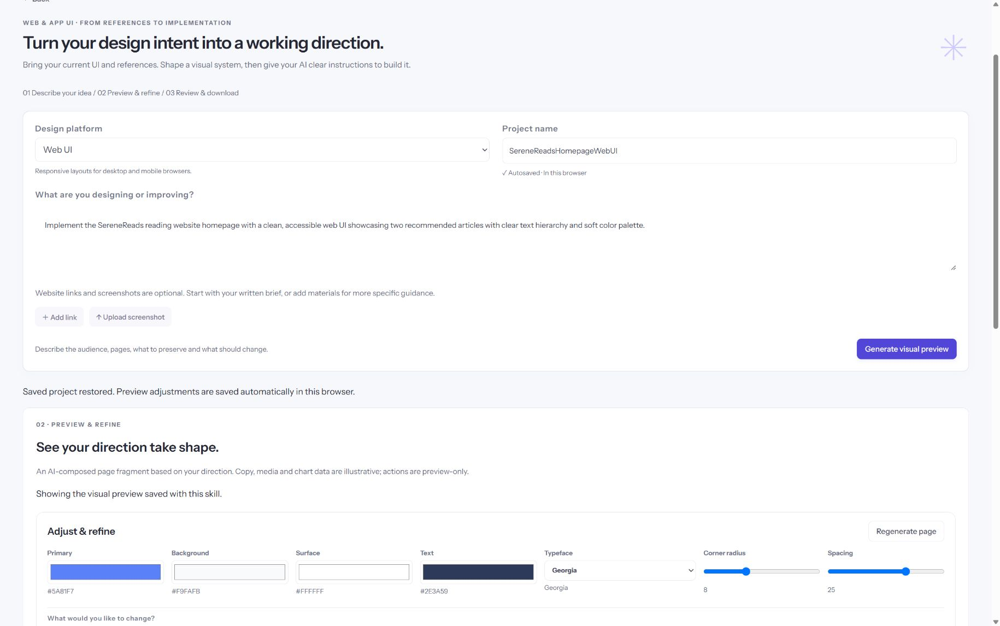
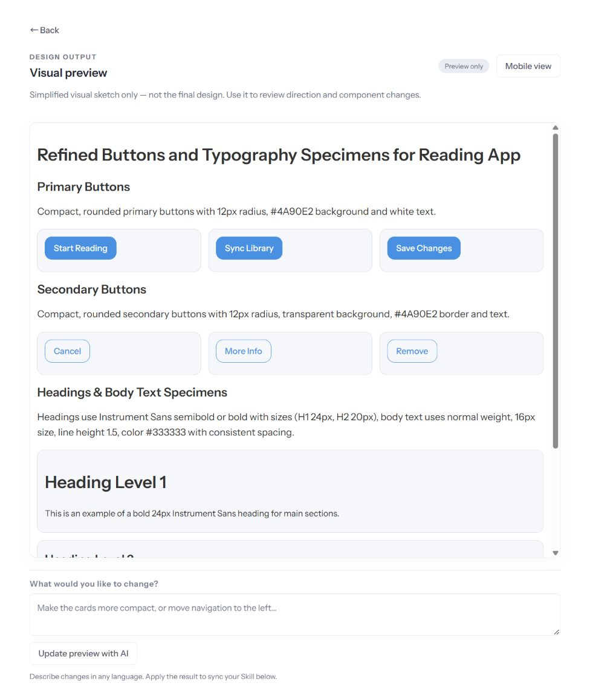

# SkillForge

**Turn design intent into an editable Skill for an AI coding assistant.**

SkillForge is a design engineering portfolio project for designers who want to turn written requirements, reference websites and screenshots into a visual direction and a reusable implementation brief. It supports Web UI, iOS and Android design guidance.



## The problem

Designers often collect references, interpret their visual language, and repeatedly explain the same decisions to an AI coding assistant. SkillForge makes those decisions visible and editable before handing them off as `SKILL.md` and `PROJECT-SPEC.md`.

## Core workflow

1. Describe what you are designing or improving. Links and screenshots are optional; each material group can contain multiple attachments.
2. Let AI infer whether the request needs a complete UI system or a focused component refinement. Override the scope manually when needed.
3. Review a simplified page fragment or component specimen board. Adjust color, typography, radius and spacing, or request changes with AI.
4. Compare Before / After and apply or reject a proposed change.
5. Edit the live Skill. Preview-controlled rules stay read-only and synchronized; other instructions support Undo / Redo.
6. Copy the complete Skill or download both handoff documents for use with an AI coding assistant.

Projects autosave to the current browser. The workspace supports resizable preview/editor columns, a collapsible sidebar and fullscreen preview/editing.



## Design decisions

- **Specific audience:** designers directing AI implementation, rather than a general-purpose prompt library.
- **Visible decisions before handoff:** previews help users evaluate the direction before relying on generated instructions.
- **Different scope, different preview:** component refinements do not invent a whole new product interface.
- **Human approval:** AI preview changes remain proposals until accepted.
- **One source of truth:** confirmed visual settings update the locked section of the live Skill.
- **Low-friction editing:** optional references, autosave, adjustable columns and fullscreen modes reduce setup and scrolling.

## Run locally

Requires **Node.js 22 or newer**. There are no third-party runtime packages to install.

1. Clone this repository and open its folder.
2. Copy `.env.example` to `.env`.
3. Set `OPENAI_API_KEY` in your local `.env`.
4. Run:

```sh
npm start
```

Open `http://127.0.0.1:5173/`. Restart the server after changing environment variables. AI generation requires a valid API key and incurs provider usage charges; there is no mock fallback.

```sh
npm test
```

The automated suite exercises validation, provider failures, visual refinement, scope rules, screenshot handling, document synchronization, copy, and editing history. API tests use a stub transport; they do not establish live model quality or account access.

## Architecture

| Area | Implementation |
| --- | --- |
| Interface | Vanilla JavaScript, HTML and CSS; Instrument Sans |
| Visual preview | Structured model output rendered with DOM elements, not executable model HTML |
| Server | Node.js HTTP server |
| AI | Server-side OpenAI Responses API calls |
| Persistence | Browser localStorage; no shared project database |
| Handoff | Markdown Skill and project design specification |

`dist/` contains the directly served frontend source; it is intentionally committed. `server.mjs` serves the application and routes API requests. `references.mjs` handles reference analysis, previews and design packages. `ai.mjs` handles Skill generation, refinement and playground execution. Tests live in `test/`.

## Data and limitations

- API keys belong only in server environment variables. `.env` files and local hosting metadata are excluded from Git.
- Submitted briefs, selected screenshots, reference text and relevant Skill content are sent to the AI provider when invoking AI features. Requests use `store: false`; provider data policies still apply.
- Screenshots are held in browser memory for submission and are not stored with saved projects. The server checks image signatures and size limits. Up to five website/image pairs are accepted across material groups; images are limited to 3 MB each and 8 MB combined.
- Website analysis reads accessible static HTML, not a live authenticated browser session. Screenshot-derived measurements and fonts are estimates.
- Previews are simplified design sketches, not final websites or compiled native apps. Native behavior must be verified in an implementation environment.
- Generated Skill files are instructions for a compatible AI workflow, not executable applications. They do not guarantee exact output across assistants.
- Saved projects are local to a browser and origin. They do not automatically transfer from localhost to a hosted domain.

## Portfolio and deployment

This repository currently runs a **local prototype**. `127.0.0.1` is not a public demo URL. The Node server is deliberately bound to loopback and validates local host/origin values.

For a portfolio, link a project case study to this repository and a separately hosted demo. GitHub Pages can serve static assets, but cannot run this Node API. A full AI-backed demo needs a Node web service, production host/origin configuration, server-side secrets, and access/usage controls before public exposure.

See [Portfolio presentation and deployment notes](docs/PORTFOLIO.md) for a practical launch plan. Do not deploy the current local server unchanged as an unrestricted public AI service.

## Project status

An AI-assisted portfolio prototype focused on interaction design and the reference-to-implementation workflow. No user research results or production usage metrics are claimed. Future work includes hosted access controls, broader preview rendering, and usability evaluation with designers.
